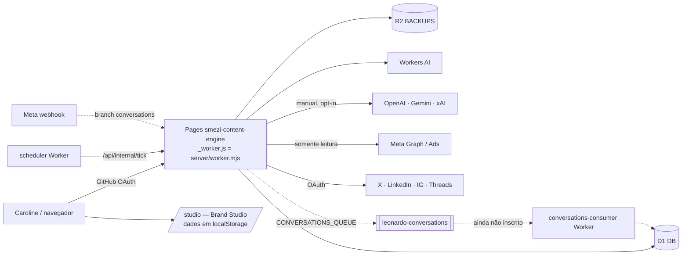

# Auditoria técnica — SMEZI Ecosystem

**Data:** 23/11/2026 · **Responsável:** Claude Code · **Base auditada:** clone completo de `gestaoautop-dotcom/smezi` (18 branches remotas)

Este documento registra o estado **real** do código. Nada foi alterado, mesclado ou implantado. Nenhum segredo foi lido ou impresso: apenas nomes de variáveis aparecem aqui.

### Limites desta auditoria

- **Pull requests:** o acesso à API do GitHub não foi concedido a esta sessão. O mapa de PRs foi reconstruído pelos commits (`#1`, `#2`, `#7`). Os PRs abertos `#3`–`#6` não puderam ser confirmados.
- **Testes:** o ambiente não tem acesso ao npm, então `jose`, `miniflare` e `wrangler` não foram instalados. Os testes que dependem deles não rodaram aqui (ver §9). **Não declaro esses testes como aprovados.**
- **Produção:** verificada só pelas respostas públicas de `smezi-content-engine.pages.dev`. Painel Cloudflare, D1, filas e segredos não foram consultados.

---

## 1. Inventário do repositório

Existem **duas linhagens de código** que compartilham só os 4 primeiros commits:

| Linhagem | Branch de referência | O que contém | Hospedagem |
|---|---|---|---|
| **Brand Studio** (estático) | `main` (5 commits) | Brand Studio, Brand Brain, Brand Guide, biblioteca de modelos, base curada `data/` (31 ofícios), `brain/cws/identity-core.v1.json` (rascunho) | `vercel.json`; dev server local |
| **Leonardo / Content Engine** (Cloudflare) | `feature/content-engine-caroline-v1` (96 commits) | Tudo do Brand Studio (copiado para `/studio`) + backend Worker (`server/`), D1, R2, OAuth das redes, Meta Ads somente leitura, Workers AI, Laboratório de IA | **Cloudflare Pages `smezi-content-engine` — em produção** |
| Site institucional | `v4`, `gh-pages`, `backup/pre-v3-cases`, `feature/cases-demos` | Site SMEZI V3/V4 e cases | GitHub Pages (`deploy-v4.yml`) |

Arquivos principais da linhagem Leonardo:

```
server/worker.mjs            roteador da API (Pages _worker.js)
server/security.mjs          JWT (jose), cookies, selagem AES de tokens, origin check
server/auth.mjs              login GitHub OAuth + PKCE, 1 usuário (GITHUB_ALLOWED_ID)
server/store.mjs             D1: records versionados, aprovações por digest, quotas, auditoria, backup R2
server/social.mjs            OAuth/publicação X, LinkedIn, Instagram, Threads
server/instagram-unified.mjs Login for Business da Meta + verificação do ativo IG
server/facebook-pages.mjs    conexão da Página CWS
server/social-read.mjs       leitura Graph (somente leitura)
server/queue.mjs             agendamento + tick (publicação) — DESLIGADO em produção
server/ai.mjs                geração de rascunho via Workers AI (env.AI + AI_MODEL)
server/official-ai.mjs       Laboratório: OpenAI / Gemini / xAI, manual, opt-in
server/meta-ads.mjs          Meta Ads Graph (somente leitura)
server/leonardo-ads.mjs      snapshots, histórico e recomendações revisáveis de Ads
scheduler/worker.mjs         Worker cron que chama /api/internal/tick
engine/*.js                  frontend do painel (content-engine.html)
migrations/0001, 0002        schema D1
```

## 2. Mapa de branches e pull requests

```
main ─┬─ (#1 brand-brain-guide, #2 template-library: squash) ─ identity-core CWS
      │
      └─ content-engine-caroline-v1  ◄── PRODUÇÃO (Pages)
            ├─ (#7 Laboratório de IA, mesclado 23/11)
            ├─ leonardo-official-ai-only   árvore IDÊNTICA à content-engine (conteúdo já entrou via #7)
            ├─ leonardo-conversations-phase1  +25 commits: webhook Meta, fila, consumer, migration 0003
            ├─ leonardo-jade-agents           +1: agentes Leonardo + Jade, memória de pesquisa, migration 0004
            ├─ leonardo-grok-content-agents   +1: catálogo estático dos agentes Grok (só referência)
            └─ leonardo-claude-code-github    +3: CLAUDE.md, workflow manual do Claude Code
```

| Branch | À frente da base | Atrás | Estado | Recomendação |
|---|---|---|---|---|
| `feature/content-engine-caroline-v1` | 92 vs main | 1 vs main | **Produção** | Tratar como linha principal de fato; trazer o commit do `identity-core` de `main` |
| `feature/leonardo-official-ai-only` | 0 de diff | — | Redundante (#7) | Arquivar após sua confirmação (não apagar sem autorização) |
| `feature/leonardo-conversations-phase1` | +25 | 1 | Código + testes; consumer sem fila | Revisar e mesclar primeiro (migration 0003) |
| `feature/leonardo-jade-agents` | +1 | 1 | Não implantado (`/agents.html` cai no painel) | Mesclar depois do 0003 (migration 0004 já reserva o número) |
| `feature/leonardo-grok-content-agents` | +1 | 1 | Só catálogo de nomes | Mesclar junto com Jade ou descartar após confirmação |
| `feature/leonardo-claude-code-github` | +3 | 1 | Workflow manual com `contents: write` | Mesclar só se você quiser cobrança da API Anthropic via Actions |
| `feat/twobrain-memory-foundation` | +3 vs main | 1 | Só documentação (contratos, arquitetura) | Base conceitual do Two Brain — aproveitar |
| `feat/twobrain-personal-workspace` | +1 vs main | 1 | Protótipo em localStorage | Não promover; usar só como referência de UX |
| `feature/ai-sales-agent` | +5 vs main | 1 | Worker separado, D1 próprio, WhatsApp + OpenAI; **nunca implantado** | Duplica webhook/fila do Conversations — não seguir sem decisão |
| `teste/brand-studio-v1` | +4 | 4 | Protótipo antigo, superado por #1/#2 | Arquivar |
| `cursor/*` | já em main (#1, #2) | — | Mesclado | Arquivar |
| `v4`, `gh-pages`, `backup/*`, `feature/cases-demos` | — | — | Site institucional | **Não tocar** (regra 17) |

## 3. Arquitetura atual



Linhas tracejadas = existe em branch, não confirmado em produção.

**Achado central:** o Brand Studio (marcas, Brand Brain, peças) vive **só no `localStorage` do navegador** (`smezi-brand-studio-v1`, `smezi-content-studio-v2`). O backend D1 guarda as memórias, ideias e posts do Leonardo, mas **não conhece marcas**. Hoje não existe uma fonte única de verdade para a identidade das marcas.

## 4. Estado das integrações

Escala da §10 do handoff: 1 código · 2 credencial · 3 conta autorizada · 4 permissões · 5 leitura testada · 6 escrita testada · 7 automação ativa.

| Integração | Nível comprovado | Evidência / observação |
|---|---|---|
| GitHub OAuth (login) | 1–2 ✔ | `/api/status`: `authChecks` todos `true` |
| D1 / R2 | 2 ✔ | `/api/status`: `database:true`, `backups:true` |
| Workers AI | 2 ✔ | `ai:true`; chamada real não verificada |
| Instagram (publicação) | 1–2 ✔ | `providers.instagram:true`; publicação **desligada** (`publishing:false`). `IG_ASSET_EMPTY` foi substituído por códigos específicos (`IG_MISSING_PAGE_PERMISSIONS`, `IG_PAGE_ACCESS_UNAVAILABLE`, `IG_DIRECT_*`, `IG_ASSET_MULTIPLE`). Se foi resolvido na Meta, só o endpoint autenticado `/api/diagnostics/instagram/oauth` mostra |
| Facebook Página | 1 ✔ | Conexão da Página CWS + leitura Graph testadas com mocks |
| X, LinkedIn, Threads | 1–2 ✔ | Credenciais presentes (`true`); OAuth real não verificado |
| TikTok, YouTube | 0 | Só arquivos de verificação de domínio do TikTok; não há adaptador |
| Meta Ads | 2 ✔, modo somente leitura | `metaAds.configured:true`; token único da conta (`META_ACCESS_TOKEN`); sem rota de escrita (correto) |
| Outras plataformas de Ads | 0 | Inexistentes |
| Meta webhook (Conversations) | 1 | Na branch; `/api/webhooks/meta` em produção respondeu 4xx — não é possível distinguir "rota existe e recusou" de "rota ausente" sem um teste de handshake |
| Cloudflare Queue + consumer | 1 | `wrangler.conversations.jsonc` **sem** binding de fila e sem D1 (intencional, segundo `docs/conversations-deploy.md`) |
| WhatsApp | 0 no Leonardo | Só no `ai-sales-agent`, não implantado |
| Scheduler (cron) | 1–2 | `scheduler:false` em produção |

## 5. Banco de dados e memória

| Migration | Branch | Tabelas | Observação |
|---|---|---|---|
| 0001 | produção | `records` (versionado por `root_id` + digest), `approvals`, `connections` (tokens selados), `jobs`, `clients`, `client_history`, `usage_limits`, `audit`, `metric_snapshots`, `tracked_links`, `click_counts`, `scheduler_heartbeat` | Bom núcleo append-only |
| 0002 | produção | `meta_ads_snapshots`, `meta_ads_reviews` | Recomendações exigem decisão humana |
| 0003 | conversations | `conversation_webhook_events` | Deduplicação por `mid` |
| 0004 | jade-agents | `agents`, `agent_versions`, `agent_memories` (escopo, tipo, status, origem), `agent_conversations`, `agent_messages` | **O que existe de mais próximo do Two Brain** |

Memória hoje:
- **Isolamento:** toda tabela usa `owner` = ID do usuário GitHub. Não existem `workspace_id`, `brand_id`, `project_id` nem `campaign_id`. O escopo da §5 do handoff (Workspace → Marca → Projeto → Campanha → Agente) ainda não existe.
- **Tipos de memória:** `records.memories` (autoral, com `kind`, onde `hipotese` é excluída da geração) e `agent_memories` (rascunho / verificada / contestada). Busca por palavra-chave; não há embeddings nem grafo.
- **Identity Core CWS:** JSON em `main`, `status: draft_pending_user_approval`. Não é lido por nenhum código.

## 6. Agentes de IA

| Caminho | Provedores | Estado | Controles |
|---|---|---|---|
| `server/ai.mjs` `/api/generate` | Workers AI | Produção (`ai:true`) | Quota 30/dia, nunca aprova, só rascunho |
| `server/official-ai.mjs` `/api/ai/ask` + `ai-lab.html` | OpenAI Responses, Gemini, xAI Responses | **Página em produção**; só chama se `LEONARDO_EXTERNAL_AI_ENABLED=true` **e** o provedor estiver em `LEONARDO_AI_ALLOWED_PROVIDERS` | Quota 10/dia por provedor, `max_output_tokens: 512`, `store:false` na OpenAI, nada é salvo |
| `server/agents.mjs` (Jade + Leonardo) | Workers AI | Branch, não implantado | 15 colaborações/dia; notas de agente entram como rascunho |
| Anthropic / Claude | — | **Não há adaptador**; só o workflow de dev (opt-in) | — |
| Catálogo Grok | — | 14 nomes, sem prompts nem acesso | Explicitamente "não conectado" |

Ausências: interface comum de provedor, registro de uso e custo por chamada (a resposta traz tokens, mas eles não são persistidos), roteamento por papel (Strategist, Copywriter…).

## 7. Recursos completos, parciais e ausentes

**Matriz pedida — Módulo | Implementado | Testado | Em produção | Pendências | Próxima ação**

| Módulo | Implementado | Testado | Em produção | Pendências | Próxima ação |
|---|---|---|---|---|---|
| Brand Studio / Brand Brain / Guide | Sim (frontend) | Sim (unitários rodaram aqui ✔) | Sim, em `/studio` | Dados só no navegador; sem multi-dispositivo | Persistir marcas no D1 (Etapa 3) |
| Biblioteca de modelos (1080×1350 etc.) | Sim | Sim ✔ | Sim | Uma peça por vez; exporta PNG único + JSON | Base do Design Engine |
| Content Studio em lote (galeria, ZIP, PDF) | **Não** | — | Não | Tudo | Primeiro fluxo (§10) |
| Leonardo painel (memórias, ideias, versões, aprovação, CRM, backup) | Sim | Testes existem (não rodaram aqui) | Sim | Escopo por marca | Manter |
| Publicação agendada | Sim | Testes existem | Desligada | Validar OAuth por rede | Não ativar sem autorização |
| Laboratório de IA (OpenAI/Gemini/xAI) | Sim | Testes existem | Página sim; chamadas dependem de flags | Registro de custo | Validar 1 chamada real por provedor com sua autorização |
| Agentes Jade + Leonardo | Sim | Testes existem | Não | Migration 0004 | Revisar PR depois do 0003 |
| Conversations fase 1 | Webhook + consumer | Webhook 4/4 ✔ aqui | Não confirmado | Fila, bindings, permissão `instagram_manage_messages`, Messenger | Ver §8 |
| Meta Ads somente leitura | Sim | Testes existem | Sim | Token único | Manter |
| Two Brain | Contratos (docs) + protótipo local | Parcial | Não | Tudo no servidor | Evoluir a partir de 0004 + contratos |
| Multitenancy | **Não** | — | — | `workspace_id`, papéis, ACL | Etapa 2 |
| AI Sales Agent | Starter | Não | Não | Duplica Conversations | Decidir manter/arquivar |

## 8. Problemas técnicos identificados

Ordem de severidade:

1. **Produção sai de uma branch de feature.** `content-engine-caroline-v1` está 92 commits à frente de `main` e 1 atrás. `main` não representa o que está no ar.
2. **Sistema de um único usuário.** `auth.mjs` aceita um único `GITHUB_ALLOWED_ID`. O consumer usa esse mesmo ID como dono. Multi-cliente exige uma camada nova de identidade e escopo.
3. **Brand Brain fora do banco.** Limpar o navegador apaga as marcas. O backup R2 do Leonardo não cobre o Studio.
4. **Conta Instagram fixa no código:** `instagram-unified.mjs` usa como fallback o ID `17841452697239527` e o usuário `cws_work`. Isso bloqueia outros clientes.
5. **Mensagens do Messenger são descartadas em silêncio.** O webhook aceita `object:'page'`, mas o consumer só aceita conexões `instagram`. O evento é confirmado (`ack`) sem ser registrado.
6. **Permissão de mensagens ausente.** O login atual concede `instagram_basic` e `instagram_content_publish`. O consumer exige `instagram_manage_messages`, então mesmo com o flag ligado o status seria `missing_permission` (comportamento seguro).
7. **Dois caminhos de IA paralelos** (Workers AI e APIs oficiais) sem contrato comum nem registro de custo persistido.
8. **Nenhuma integração com Anthropic** no produto, apesar da arquitetura multi-IA.
9. **Branch redundante:** `leonardo-official-ai-only` tem a árvore idêntica à de produção.
10. **Duplicação planejada:** o `ai-sales-agent` tem webhook Meta, D1 e OpenAI próprios, em paralelo ao Conversations.
11. **Workflow Claude Code** pede `contents: write` + `pull-requests: write` + `id-token: write`. É manual e opt-in, mas pode gerar cobrança da API.
12. **Lockfile e dependências:** `miniflare` está em versão beta (`5.20261023.3-beta`).

Pontos fortes que devem ser preservados: versões imutáveis com digest, aprovação vinculada ao digest exato, `INSERT … WHERE EXISTS` contra corrida, ausência de reenvio automático em entregas incertas, tokens selados por `owner:provider`, HMAC em tempo constante, CSP rígida, mensagens de diagnóstico que não vazam segredos.

## 9. Build e testes executados nesta auditoria

Node v22.23.5. Sem acesso ao npm.

| Teste | Resultado |
|---|---|
| `test/brain-core.test.js` | ✔ passou |
| `test/templates.test.js` | ✔ passou |
| `test/knowledge.test.js` | ✔ passou (30) |
| `test/conversations-webhook.test.mjs` (branch conversations) | ✔ 4/4 |
| `test/content-engine.test.js` | 3 passaram, 1 não rodou (`esbuild` ausente) |
| facebook-pages, instagram-unified, social-read, server, runtime, leonardo-ads, official-ai | **não executados**: dependem de `jose`/`miniflare` |
| `npm run build` | não executado (depende de `esbuild` + `jose`) |

Para completar: `npm ci && npm test && npm run build` em um ambiente com rede. A CI das branches já faz isso.

## 10. Plano de implementação incremental

Cada etapa vira uma branch `claude/*` com PR para revisão. Nenhum merge ou deploy sem a sua autorização.

**Etapa 1 — Consolidação de branches** (sem mudar comportamento)
- Definir `content-engine-caroline-v1` como linha principal (ou levá-la para `main`), trazendo o commit `identity-core`.
- Ordem de merge: conversations (0003) → jade-agents (0004) → grok catalog → claude-code (opcional).
- Arquivar com tag (sem apagar): `leonardo-official-ai-only`, `teste/brand-studio-v1`, `cursor/*`.

**Etapa 2 — Contratos comuns** (migration 0005, aditiva)
- `workspaces`, `brands` (`workspace_id`), `brand_versions` (Brand Guide versionado com aprovação), `memberships`.
- Colunas `workspace_id` e `brand_id` nas novas tabelas. As antigas recebem o workspace padrão `cws`, sem reescrever dados.
- Interface `aiProvider.run({role, task, input, budget})` envolvendo Workers AI e `official-ai`, com tabela `ai_usage`.

**Etapa 3 — Brand Brain persistente**
- `POST/GET /api/brands`: importa o `localStorage` atual (botão "enviar para o Leonardo"), mantendo o localStorage como cache.
- Regras permanentes separadas das preferências observadas.

**Etapa 4 — Primeiro fluxo funcional (Content Studio em lote)**
Marca → memória carregada → 12 posts → galeria → edição → exportação:
- Conteúdo: base curada `data/` + memórias da marca. Workers AI só quando ligado (custo zero no caminho padrão).
- Peças: reutilizar `lib/templates.js` + `templates-render.js` (1080×1350) como documentos JSON com camadas e coordenadas.
- Tabelas `content_batches` e `content_items` (versões imutáveis, como `records`).
- Galeria: seleção múltipla, aprovar/rejeitar, regenerar só o texto ou só o template.
- Exportação: PNG/JPG por peça, ZIP sem dependência (store-only), JSON editável e legendas em `.txt`/`.csv`. PDF de aprovação na segunda iteração.
- Aprovações e edições geram registros de diferença (base da Etapa 7).

**Etapas 5–7:** Leonardo consumindo marcas e lotes; ativação controlada de Conversations e publicação; aprendizado a partir das diferenças aprovadas, sempre como sugestão revisável.

## Decisões que dependem de você

1. **Linha principal:** promover `content-engine-caroline-v1` para `main` (ou criar `production`)? Hoje a produção sai de uma branch de feature.
2. **Acesso de escrita ao GitHub** para esta sessão, para abrir branches e PRs. Agora só tenho leitura.
3. **Multi-cliente:** manter login GitHub de um único usuário nesta fase (todas as marcas sob a conta CWS, com `workspace_id` já no schema) ou já planejar login de clientes?
4. **`ai-sales-agent`:** manter como referência ou arquivar?
